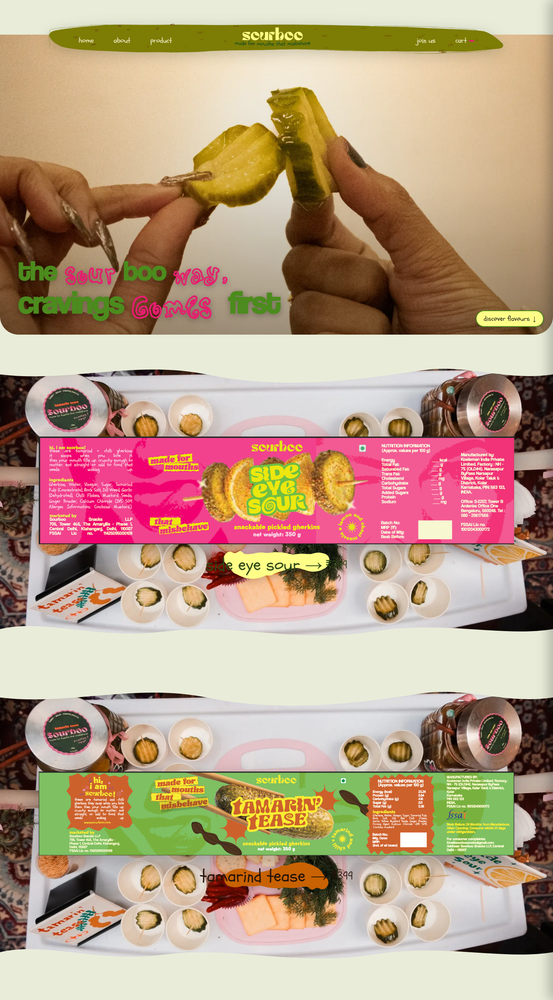
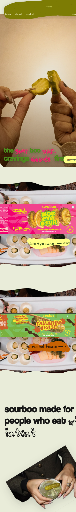
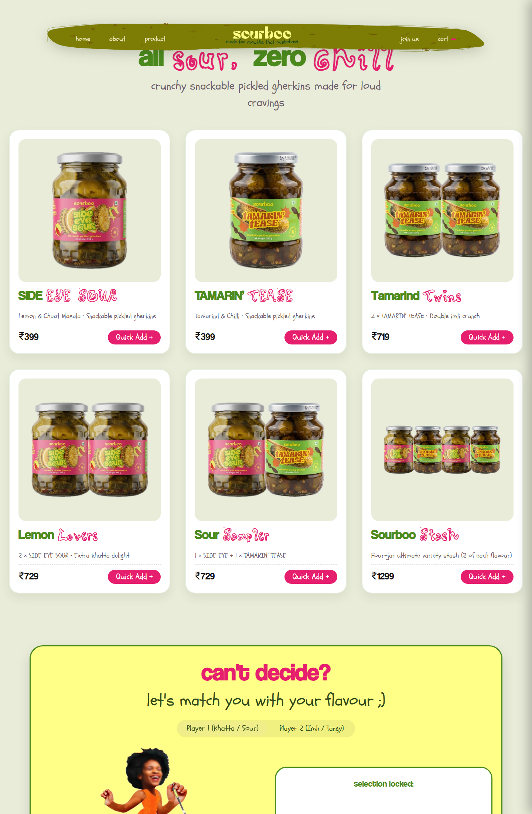
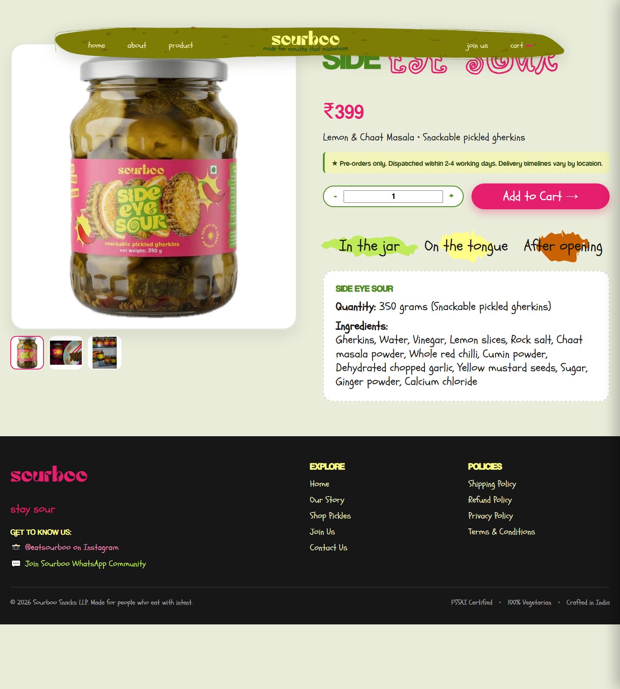
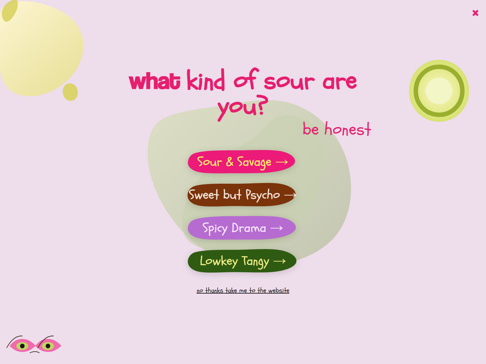
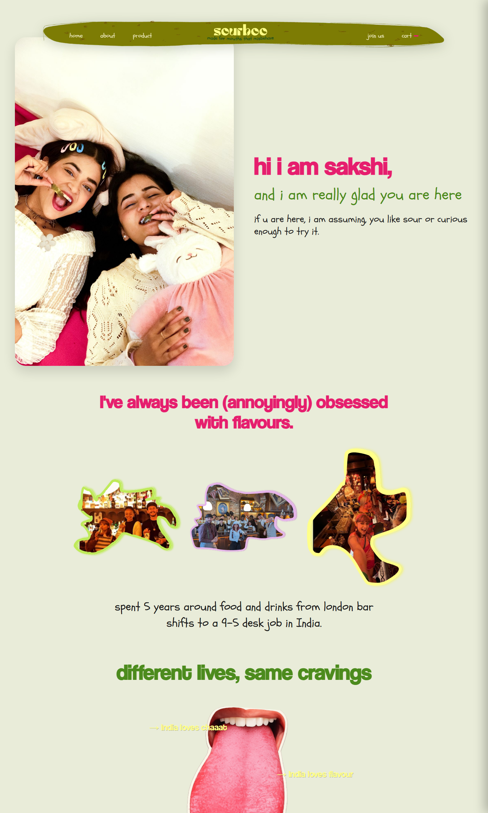

# SOURBOO: COMPLETE WEBSITE REDESIGN & SHOPIFY 2.0 THEME
> **Creative Direction**: *"SOURBOO SNACK DIARY"*  
> **Core Philosophy**: **SAME BRAND. DIFFERENT DESIGN.**



Welcome to the complete, production-ready redesign of **[Sourboo](https://www.sourboo.com/)** — handcrafted pickled gherkins for cravings, late nights, desk breakdowns, and misbehaving mouths.

This repository contains the complete **UI/UX Design Suite**, **Figma Design Architecture**, **Interactive Prototype Simulator**, and production-ready **Shopify Online Store 2.0 Theme**.

---

## 🌟 Highlights & Creative Execution

### 1. "Same Brand. Different Design."
Previous redesign attempts simply duplicated the old layout with repetitive full-width bands and symmetrical blocks. This redesign reimagines Sourboo as an **unconventional food culture publication & indie zine ("The Snack Diary")**:
- **Editorial Asymmetry**: Dynamic broadsheet layout rhythms with offset columns, unexpected cropping, and tactile washi-tape callouts.
- **Hero Broadsheet**: Centers the authentic hands-holding-pickles photograph (`hero-placeholder.webp`) inside an asymmetric composition with overlapping Coolvetica typography (*"CRAVINGS COME FIRST. EVERYTHING ELSE CAN WAIT."*).
- **The Sour Dossier**: Staggered 3-column cards replacing old horizontal bands with real jar cutouts, 3-point taste meters (Sourness 5/5, Crunch 5/5, Spice 3/5), and 1-click Quick Add.
- **The Moments Archive**: Layered asymmetric gallery of campaign posters (*Post Cry Snack*, *Late Night Munchies*, *Girl Dinner But Sour*, *Desk Cravings*).

### 2. 100% Brand Asset & Typography Preservation
- **Fonts**: Local font files active in theme assets:
  - `Coolvetica` (`coolvetica.ttf`): Display punch & section mastheads.
  - `Rascal` (`rascal.ttf`): Expressive titles (*"the sourboo way ¬‿¬"*).
  - `Schoolbell` (`Schoolbell-Regular.ttf`): Handwritten sticky notes & tasting notes (*"mouth wants to misbehave"*).
- **Assets**: All 148 original assets verified and integrated, including packaging labels, jar photography, and founder portraits (`about-cover.JPG`).

### 3. Full 4-Step Personality Quiz Experience
Preserves the signature Sourboo personality popup:
1. **Quiz Question**: *"what kind of sour are you? be honest"* with 4 brand buttons (*Sour & Savage*, *Sweet but Psycho*, *Spicy Drama*, *Lowkey Tangy*).
2. **Personalized Lead Capture**: Custom greeting based on choice + Email & WhatsApp inputs + no-spam pledge.
3. **Coupon Reveal**: Unlocks coupon code `SOURBABE05` with 1-click clipboard copy and confetti trigger.
4. **Validation States**: Full inline error handling.

---

## 📁 Repository Directory Structure

```
Sourboo-new-design/
├── figma-design/                               # Complete Figma UI/UX Architecture
│   ├── figma-sourboo-snack-diary.json          # Machine-readable Figma Document & Tokens Schema
│   ├── sourboo-figma-design-suite.html         # Interactive Figma Canvas & Prototype Simulator
│   ├── sourboo-snack-diary-widget.html         # Compact Generative UI Direction Selector
│   └── sourboo-snack-diary-figma-spec.md       # Complete UI/UX Specification & Blueprint
├── shopify-theme/                              # Shopify Online Store 2.0 Production Theme
│   ├── layout/theme.liquid                     # Master Liquid Layout with Drawer & Popup integrations
│   ├── templates/                              # JSON Page Templates (index, collection, product, etc.)
│   ├── sections/                               # Modular Shopify Sections (Hero, Dossier, Manifesto, etc.)
│   ├── snippets/                               # Reusable Snippets (Nav, Cart Drawer, Quiz Modal, Icons)
│   ├── assets/                                 # 148 Verified Brand Assets, SVGs, and 3 Local TTF Fonts
│   ├── config/settings_schema.json             # Theme Customizer Settings & Schema
│   └── locales/en.default.json                 # English Copy & Translations
├── docs/                                       # Project Audit, Specifications & Test Reports
│   ├── stage1-audit.md                         # Complete 148-Asset Inventory & Feature Analysis
│   ├── stage2-design-system.md                 # Design System & CoolRascal Typography Engine
│   ├── stage6-testing-and-migration-report.md  # 60/60 Automated Test Suite & Backend Migration Plan
│   └── screenshots/                            # Visual Proofs & Device Screenshots
│       ├── home-desktop.png
│       ├── home-mobile.png
│       ├── shop-desktop.png
│       ├── product-detail.png
│       ├── about-desktop.png
│       └── popup-modal.png
├── preview_server.js                           # Local HTTP Preview Server (Zero-Dependency Node.js)
├── test_suite.js                               # 60-Assertion Automated Verification Suite
└── README.md                                   # Master Project Documentation
```

---

## 🚀 Quick Start: Run Locally

### 1. Launch the Local Preview Server
You can run the interactive storefront locally without needing Shopify CLI:

```bash
node preview_server.js
```
Open **`http://localhost:3456`** in your browser to experience:
- Live navigation across all routes (`/`, `/collections/all`, `/products/sideeyesour`, `/pages/about`, `/pages/contact`, `/pages/join-us`).
- Live Slide-Out Cart Drawer with real cart totals and checkout triggers.
- Live Personality Popup Quiz with all 4 states and `SOURBABE05` coupon flow.
- Interactive handwritten product tabs (*In the jar*, *On the tongue*, *After opening*).

### 2. Run the 60-Assertion Automated Test Suite
Verify that all routes, headings, assets, and responsive elements function properly:

```bash
node test_suite.js
```
*Expected Result: `60 / 60 Passed (100% Green)`*

---

## 🎨 Figma Design System & Prototype

The UI/UX design is organized into **6 structured Figma pages**:

| Page | Title | Scope & Features |
| :--- | :--- | :--- |
| **01** | **Brand Foundation** | 3 Visual Exploration Directions, 8 Color Tokens, 3 Font Scales, Asset Inventory. |
| **02** | **Design System** | Auto Layout components: Nav Bar, Button Matrix, Dossier Tabs, Badges & Stickers. |
| **03** | **Desktop Website** | 1440px Artboards: Broadsheet Hero, The Sour Dossier, Manifesto, Moments Archive, PDP. |
| **04** | **Mobile Website** | 390px Touch-First Frames: Mobile Home, Shop, PDP, About, and Menu Overlay. |
| **05** | **Popup Experiences** | Full 4-state personality quiz engine with coupon reveal `SOURBABE05`. |
| **06** | **Interactive Prototype**| Clickable flow simulator connecting Nav, Shop, PDP, Quick-Add Drawer, and Quiz. |

### How to Inspect or Import:
- Open [`figma-design/sourboo-figma-design-suite.html`](figma-design/sourboo-figma-design-suite.html) in any browser for an interactive Figma-like canvas inspection experience.
- Import [`figma-design/figma-sourboo-snack-diary.json`](figma-design/figma-sourboo-snack-diary.json) into Figma using standard JSON/Tokens Studio plugins.

---

## 🛍️ Shopify Deployment

To push this theme to your live or staging Shopify store:

```bash
cd shopify-theme
shopify theme push --store your-store.myshopify.com
```

Or connect this GitHub repository directly in **Shopify Admin → Online Store → Themes → Add Theme → Connect from GitHub**.

---

## 📸 Screenshots Showcase

| Desktop Homepage | Mobile View |
| :---: | :---: |
|  |  |

| Shop Collection | Product Detail Page (PDP) |
| :---: | :---: |
|  |  |

| Personality Quiz Popup | About / Founder Story |
| :---: | :---: |
|  |  |

---

## 📄 License & Credits
- **Brand & Content**: © Sourboo Foods LLP. All Rights Reserved.
- **Design & Shopify Engineering**: Redesigned for PrinceDarji / Sourboo.
