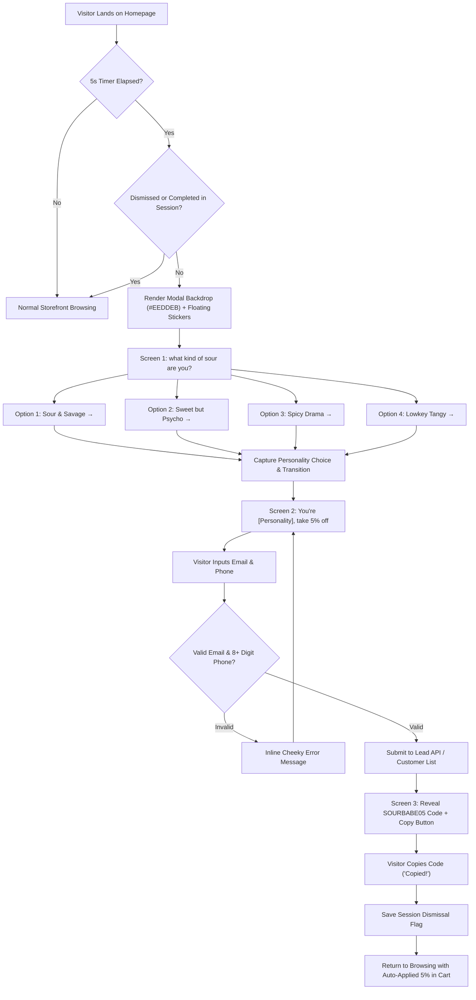

# Sourboo Complete Source-Code & Asset Audit (Stage 1)

**Role**: Senior UI/UX Designer, Creative Director & Shopify Frontend Architect  
**Project**: Sourboo Storefront Redesign for Shopify Online Store 2.0  
**Scope**: In-depth audit of `sourboo-final-main`, live website references, complete 148-asset catalog, interaction mechanics, and backend systems.

---

## 1. Existing Page Inventory

| Route | Purpose & Visual Character | Key Components & Files | Primary Visual Assets |
|---|---|---|---|
| `/` or `/home` | High-impact branded homepage combining editorial food photography, signature product bands, animated posters, and social proof. | `app/home/page.tsx`, `AboutNavbar.tsx`, `HomePosterPinboard.tsx`, `HomeHorizontalImageScroll.tsx`, `HomeReviewPhoneSection.tsx`, `CrybabyVisual.tsx`, `SiteFooter.tsx` | `hero-placeholder.webp`, `packagingbg.webp`, `sideeyepackage.png`, `tamarinpackage.png`, `postcrysnack.webp`, `latenightmunchies.webp`, `girldinner.webp`, `deskcravings.webp`, `freshingredients.svg`, `recipe-1.jpg`, `recipe-2.webp`, `review-phone.svg` |
| `/product` | Shop / catalog page displaying all 6 pickle products, an interactive 2-player flavour-matching journey, customer FAQs, and review bubbles. | `app/product/page.tsx`, `AnimatedFlavorMeters.tsx`, `ProductWordByWordReveal.tsx`, `QuickBuyButton.tsx` | `player1.svg`, `player2.svg`, `productpath.svg`, `productpath1.svg`, `side-eye-jar.svg`, `tamarin-jar.svg`, `sideeyectabg.svg`, `tamarinteasectabg.svg`, `bg-faqs.svg` |
| `/product/[slug]` | Dedicated product detail pages for individual jars and multi-packs with 3 signature handwritten information tabs, lifestyle carousel, and Quick Buy. | `app/product/[slug]/page.tsx`, `ProductDetailSections.tsx`, `ProductImageCarousel.tsx`, `ProductShareButton.tsx`, `ProductDetailCartActions.tsx` | `side-eye.webp`, `tamarin-tease.webp`, `side-eye-lifestyle.webp`, `tamarin-lifestyle.webp`, `fridge.webp`, `inthejarbg.svg`, `onthetonguebg.svg`, `afteropeningbg.svg` |
| `/popup` | Personality quiz modal (Step 1): "what kind of sour are you? be honest" with 4 bespoke hand-drawn option buttons and sticker illustrations. | `app/popup/page.tsx`, `LandingPersonalityPopup.tsx`, `LandingPopupCloseButton.tsx`, `LandingPopupDismissGuard.tsx`, `LandingPopupTextExitButton.tsx` | `image1.svg`, `image2.svg`, `image3.svg`, `image4.svg`, `button-bg-1.svg`, `button-bg-2.svg`, `button-bg-3.svg`, `button-bg-4.svg` |
| `/popup/coupon` | Lead capture & coupon delivery (Step 2): personalized heading, dual email + phone input, validation, and `SOURBABE05` code with clipboard copy. | `app/popup/coupon/page.tsx`, `LandingPopupLeadCaptureForm.tsx` | `button1.svg`, `image1.svg`, `image2.svg`, `image3.svg`, `image4.svg` |
| `/about` | Interactive editorial founder storytelling for Sakshi & Sourboo: 6 custom animated chapters, tongue flavor-mapping, and envelope letter. | `app/about/page.tsx`, `AboutTopStrip.tsx`, `IndiaLovesLines.tsx`, `AboutFlavorWords.tsx`, `AboutWordByWordReveal.tsx`, `AboutEnvelopeText.tsx`, `SectionThreeEyesSequence.tsx` | `about-cover.JPG`, `section-two-1.svg` to `3.svg`, `section-three-tongue.svg`, `eyes1.svg` to `3.svg`, `boldbg.svg`, `sourbg.svg`, `spicybg.svg`, `paper-tear.svg`, `section-six-envelope.svg`, `section-six-top-1.webp` to `3.webp` |
| `/join` | Community and collaboration landing page with direct mail, phone, Instagram, and WhatsApp connections. | `app/join/page.tsx`, `ReachUsPageTemplate.tsx` | Brand yellow `#FFFF88` background, pink typography, SVG contact icons |
| `/contact` | Customer support, order inquiries, and business communication hub. | `app/contact/page.tsx`, `ReachUsPageTemplate.tsx` | Email `cravings@sourboo.com`, Phone `+91 8120202060` |
| `/terms-and-conditions` | Brand terms and service agreements presented in Sourboo's signature high-contrast pink and yellow layout. | `app/terms-and-conditions/page.tsx`, `LegalPageTemplate.tsx` | Background `#E61E6E`, Coolvetica typography, structured legal articles |
| `/privacy-policy` | Customer data privacy statement, cookies, and regulatory information. | `app/privacy-policy/page.tsx`, `LegalPageTemplate.tsx` | Background `#E61E6E`, Coolvetica typography, structured privacy policies |
| `/refund-policy` | Transparent returns, damaged package, and refund guidelines. | `app/refund-policy/page.tsx`, `LegalPageTemplate.tsx` | 48-hour delivery damage window, customer photo verification guidelines |
| `/shipping-policy` | Domestic delivery SLAs (3-5 days metro, 5-8 non-metro), dispatch timelines (2-4 business days), and flat shipping charges. | `app/shipping-policy/page.tsx`, `LegalPageTemplate.tsx` | Standard shipping policy terms |
| `/checkout` & Cart Drawer | Slide-over cart drawer with real-time quantity updates, coupon calculation (`SOURBABE05`), flat ₹100 shipping, and checkout redirect. | `app/components/cart/CartDrawer.tsx`, `CartProvider.tsx`, `app/checkout/` | `/cart/cartcta.svg`, `/cart/cartlogo.svg`, custom quantity pills, discount feedback |

---

## 2. Feature & Functionality Inventory

```
┌────────────────────────────────────────────────────────────────────────┐
│                        SOURBOO FEATURE MATRIX                          │
├──────────────────────────┬──────────────────────┬──────────────────────┤
│ Capability               │ Current Engine       │ Target Shopify OS 2.0│
├──────────────────────────┼──────────────────────┼──────────────────────┤
│ Organic Navigation Bar   │ Next.js Image SVG    │ Liquid Custom Section│
│ Hero Section             │ WebP + Alternating H1│ Liquid Section       │
│ Full-width Product Bands │ Dual-layer WebP/SVG  │ Liquid Theme Section │
│ Poster Pinboard          │ Intersection Observer│ Pure JS + CSS Keyfram│
│ Sticky Horizontal Gallery│ Flex scroll / Touch  │ CSS Grid / Snap Drag │
│ Review Phone & Bubbles   │ Animated Keyframes   │ Custom Liquid Section│
│ Personality Quiz (Pop-up)│ Next.js Client Modal │ Standalone Section/JS│
│ 5% Lead Capture Flow     │ Next API / Supabase  │ Shopify Customer API │
│ Flavour Matcher          │ Interactive State    │ Native Liquid / JS   │
│ Handwritten Accordion    │ 3-State SVG Tabs     │ Accessible HTML/JS   │
│ Cart Drawer & Discounts  │ React Context API    │ Shopify Cart Ajax API│
│ Checkout & Payments      │ PhonePe Gateway API  │ Shopify Native Check │
└──────────────────────────┴──────────────────────┴──────────────────────┘
```

---

## 3. Brand Identity & Typography Rules

### Brand Typography System

```
Rascal.ttf                 Coolvetica.ttf             Schoolbell-Regular.ttf
[ Display Accent ]         [ Structural Headings ]    [ Handwritten Voice ]
Used for alternating      Used for bold section      Used for buttons, notes,
character styling &        headlines, prices, and     speech bubbles, product
irreverent display copy    primary brand statements   tabs & personal details
```

1. **Rascal** (`rascal.ttf`): Alternated with Coolvetica in large display headings to give Sourboo its signature rhythm where individual letters bounce between styles.
2. **Coolvetica** (`coolvetica.ttf`): Clean, dense, ultra-confident sans-serif with bespoke terminal cuts. Used for all primary headings, titles, navigation items, and structured announcements.
3. **Schoolbell** (`Schoolbell-Regular.ttf`): Casual, organic handwriting. Serves as Sourboo’s authentic personal voice for buttons, sticky notes, product tabs, speech bubbles, and founder notes.

### Core Brand Colour Tokens

```
#E9ECD9 (Sage Cream)       #E61E6E (Sourboo Pink)     #BFEA5A (Electric Lime)
[ Primary Canvas ]         [ Vibrant Brand Accent ]   [ Acid Punch & Bubbles]

#FFFF88 (Sunny Yellow)     #2F4918 (Deep Olive)       #C96A00 (Spicy Amber)
[ Accent Backgrounds ]     [ Contrast Text & Accents] [ Tamarind Warmth ]

#EEDDEB (Pop-up Lilac)     #171717 (Rich Charcoal)    #2F67FF (Dotted Line)
[ Quiz Backdrop ]          [ High-readability Type ]  [ Tongue Map Indicator]
```

---

## 4. Full Asset Inventory (148 Assets Audited)

All 148 assets have been audited and verified in `repo/sourboo-final-main/public`:

- **Root Branding & Chrome (24 files)**: `navbar.svg`, `navbar.webp`, `navbody.svg`, `navbody.webp`, `navlogo.svg`, `navlogo.webp`, `review-phone.svg`, `review-phone.webp`, `logo.svg`, `tagline.svg`, `tagline.webp`, `footerbod.svg`, `footerbod.webp`, `footer.JPEG`, `shareicon.svg`, apple icons and favicons.
- **Homepage Assets (23 files)**:
  - `hero-placeholder.webp` (264 KB) / `hero-placeholder.JPEG` (7.0 MB): Real hands holding pickle slices.
  - `packagingbg.webp` (146 KB) / `packagingbg.JPEG` (8.1 MB): Full-width textural backdrop.
  - `sideeyepackage.png` (385 KB) & `tamarinpackage.png` (592 KB): Signature product packaging strips.
  - `ctabg.svg` & `ctabg2.svg`: Brushstroke button containers.
  - Campaign posters: `postcrysnack.webp` (158 KB), `latenightmunchies.webp` (153 KB), `girldinner.webp` (118 KB), `deskcravings.webp` (752 KB), `hangoverdetox.webp` (36 KB).
  - Editorial collage: `freshingredients.svg` / `webp`, `readmyrant.webp`, `readmyrantcta.svg`, `recipe-1.jpg`, `recipe-2.webp`.
- **Personality Popup Assets (9 files)**: `image1.svg` (oil drip), `image2.svg` (center splash), `image3.svg` (lemon slice), `image4.svg` (sour eye), `button-bg-1.svg` to `button-bg-4.svg` (custom organic button backgrounds), `button1.svg`.
- **Product Catalog Assets (9 files)**: `side-eye.webp`, `tamarin-tease.webp`, `tamarind-twins.webp`, `lemon-lovers.webp`, `sour-sampler.webp`, `sourboo-stash.webp`, `side-eye-lifestyle.webp`, `tamarin-lifestyle.webp`, `fridge.webp`.
- **Product & Matcher Graphics (33 files)**: `side-eye-jar.svg/webp/png`, `tamarin-jar.svg/webp/png`, `inthejarbg.svg`, `onthetonguebg.svg`, `afteropeningbg.svg`, `player1.svg/webp`, `player2.svg/webp`, `productpath.svg`, `productpath1.svg`, `sideeyectabg.svg`, `tamarinteasectabg.svg`, `buynowbutton.svg/webp`, `buynowbuttonhover.svg/webp`, `bg-faqs.svg`, `faqquestionbg.svg`, `reviewstars.svg/webp`, `splash-green.svg`, `splash-orange.svg`.
- **About Page Graphics (38 files)**: `about-cover.JPG`, `boldbg.svg`, `sourbg.svg`, `spicybg.svg`, `eyes1.svg`, `eyes2.svg/webp`, `eyes3.svg/webp`, `section-three-eyes.svg/webp`, `section-three-tongue.svg/webp`, `section-two-1.svg/webp` to `3`, `paper-tear.svg/webp`, `section-six-envelope.svg/webp`, `section-six-top-1.webp` to `3.webp`, `lemonsqueze.gif`, `spoonofpickle.gif`, `nav.svg`.
- **Cart Graphics (3 files)**: `cartcta.svg`, `cartlogo.svg`, `cartlogo.webp`.

---

## 5. Personality Popup & Coupon Flow Diagram



---

## 6. Animation & Interaction Inventory

1. **Poster Pinboard Sequential Drop (`HomePosterPinboard.tsx`)**:
   - Trigger: IntersectionObserver at 18% viewport intersection.
   - Initial state: `translate3d(0, -140px, 0) scale(0.84) opacity(0)`.
   - Motion: `cubic-bezier(0.2, 1, 0.22, 1)` dropping to `scale(1)` with drop-shadow deepening.
   - Red Pin Animation: Staggered entry from `-130%` to `-56%` with needle drop.
   - Stagger Interval: 1,800ms between each of the 4 posters.
   - Reduced Motion: Immediate display without vertical translation.

2. **Popping Customer Review Speech Bubbles (`HomeReviewPhoneSection.tsx`)**:
   - Trigger: IntersectionObserver at 12% viewport intersection.
   - Keyframe curve: Overshoot pop (scale 0.88 -> 1.03 -> 1.0) with subtle rotation (-4deg to +4deg).
   - Stagger Delays: Bubble 1 (120ms), Bubble 2 (480ms), Bubble 3 (840ms), Bubble 4 (1180ms).

3. **Word-by-Word Scroll Opacity Reveal (`ProductWordByWordReveal.tsx`)**:
   - Words start at 26% opacity (`opacity: 0.26`) and illuminate to 100% as the reader scrolls past.

4. **Product Detail Handwritten Tab Morphing (`ProductDetailSections.tsx`)**:
   - 3 interactive SVG tab buttons ("In the jar", "On the tongue", "After opening").
   - Dynamic procedural hand-drawn brush segments with organic rotations (-18deg to +12deg) and dabs.

5. **Animated Flavour Matcher Gauges (`AnimatedFlavorMeters.tsx`)**:
   - Animated SVG meters dynamically filling to 82%, 100%, 68%, etc., representing spice, crunch, sour, and attitude.

---

## 7. Current Commerce & Backend Flow Safeguards

### Existing Production Stack
- **Catalog Snapshot**: Authoritative 6-product catalog in `src/lib/catalog/products.ts`.
- **Payment Gateway**: PhonePe PG API with server-side checksum calculation and webhook signature verification (`app/api/payments/phonepe/`).
- **Database**: Supabase PostgreSQL tables: `orders`, `order_items`, `popup_leads`.
- **Invoicing**: Zoho Books API integration creating paid invoices and fetching generated invoice PDFs.
- **Emails**: Resend transactional email API dispatching order confirmation with attached Zoho PDF.
- **Cart & Discounts**: LocalStorage cart with automatic 5% deduction for promo code `SOURBABE05` and flat ₹100 shipping fee.

### Migration Safety Rules for Shopify
1. **Never touch live production keys** or attempt DNS changes during redesign.
2. **Shopify Native Handoff**: The new Shopify storefront will utilize Shopify's native Ajax Cart API (`/cart.js`, `/cart/add.js`, `/cart/change.js`) and native Shopify checkout.
3. **Discount Parity**: Create matching 5% discount code `SOURBABE05` in Shopify Admin.
4. **Lead Storage**: Route the personality popup submissions either to Shopify Customer Accounts (with tags `sour-savage`, `sweet-psycho`, etc.) or to the existing Supabase endpoint during transition.
5. **Preserve Product Slugs**: Keep URL handles identical to existing slugs (`sideeyesour`, `tamarintease`, `tamarind-twins`, etc.) to prevent broken links.

---

## 8. Missing Information & Clarifications Needed Before Launch

1. **Shopify Store Access / Handle**: Specific Shopify store subdomain for live theme deployment.
2. **PhonePe Shopify App Installation**: Confirmation whether PhonePe's official Shopify Plugin is installed on the store.
3. **Product Inventory Quantities**: Whether items should be set as "Pre-order only" or live tracked stock in Shopify.

*Stage 1 audit complete. Proceeding to Stage 2: Design System & Tokens.*
